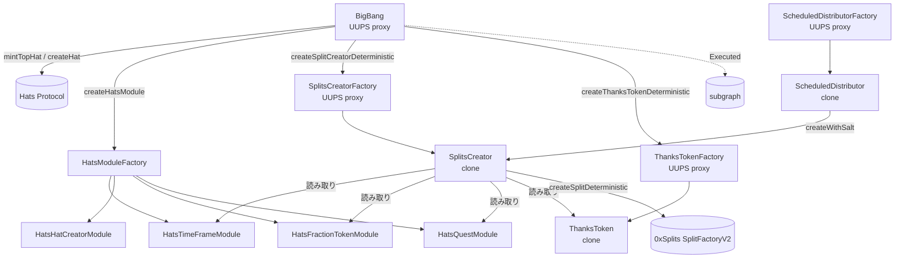

# アーキテクチャ

**ワークスペース**は Hats のツリーである。`BigBang.bigbang` が 1 回のトランザクションでワークスペースを作る。top hat を mint し、hatter hat と member hat を作り、ワークスペースごとのモジュールと creator をデプロイして、`Executed` を emit する。subgraph は、このイベントからワークスペースのインデックスを始める。

## ワークスペースごとのコントラクト {#per-workspace-contracts}

| コントラクト | デプロイするもの | 保持するもの |
| --- | --- | --- |
| HatsTimeFrameModule | HatsModuleFactory | 各着用者が hat を受け取った日時と外れた日時。ここから着用時間が決まる |
| HatsHatCreatorModule | HatsModuleFactory | hat の admin でなくても子 hat を作れる人 |
| HatsFractionTokenModule | HatsModuleFactory | ロールごとのシェアトークン。着用者はシェアの一部を他人に渡せる |
| HatsQuestModule | HatsModuleFactory | クエストと、クエストのためにエスクローに預けたシェアトークン |
| ThanksToken | ThanksTokenFactory | メンバーどうしで送るサンクス(アシストクレジット)。残高と mint 量 |
| SplitsCreator | SplitsCreatorFactory | なし。上のコントラクトを読んで 0xSplits の split を作る |
| ScheduledDistributor | ScheduledDistributorFactory | 予定された分配。実行時に split を作る |

## 報酬が届くまでの流れ {#data-flow-of-a-reward}

1. メンバーがロールを担う。`HatsTimeFrameModule` が着用時間を積み上げ、`HatsFractionTokenModule` が各ロールのシェアの分け方を記録する。
2. メンバーどうしが `ThanksToken` でサンクスを送り合う。
3. 誰かが `SplitsCreator.create` を、直接または `ScheduledDistributor` を通して呼ぶ。そのブロックの状態から配分が計算され、新しい split に固定される([SplitsCreator](./modules/splits-creator.md))。
4. split に送られた資金は、0xSplits が配分に比例して支払う。
