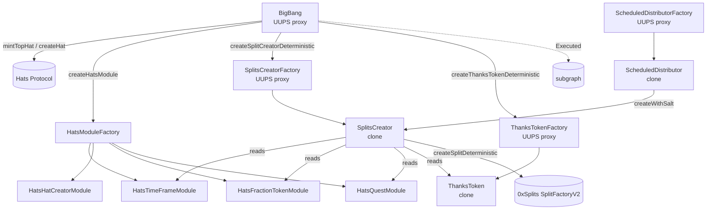

# Architecture

A **workspace** is a Hats tree. `BigBang.bigbang` creates it in a single transaction. It mints the top hat, creates the hatter and member hats, deploys the per-workspace modules and creators, and emits `Executed`. The subgraph starts indexing a workspace from that event.

## Per-workspace contracts

| Contract | Deployed by | Holds |
| --- | --- | --- |
| HatsTimeFrameModule | HatsModuleFactory | When each wearer received or lost a hat, which gives the wear time |
| HatsHatCreatorModule | HatsModuleFactory | Who may create child hats without being a hat admin |
| HatsFractionTokenModule | HatsModuleFactory | The per-role share token: a wearer can pass part of the share to others |
| HatsQuestModule | HatsModuleFactory | Quests, and the share tokens held in escrow for them |
| ThanksToken | ThanksTokenFactory | Peer-to-peer thanks ("assist credit"): balances and minted amounts |
| SplitsCreator | SplitsCreatorFactory | Nothing. It reads the contracts above and creates 0xSplits splits |
| ScheduledDistributor | ScheduledDistributorFactory | Scheduled distributions that create a split when they run |

## Data flow of a reward

1. Members wear roles. `HatsTimeFrameModule` accumulates wear time, and `HatsFractionTokenModule` records how each role share is divided.
2. Members thank each other with `ThanksToken`.
3. Someone calls `SplitsCreator.create`, directly or through `ScheduledDistributor`. The allocations are computed from that block's state and fixed in a new split ([SplitsCreator](./modules/splits-creator.md)).
4. Funds sent to the split are paid out by 0xSplits in proportion to the allocations.
