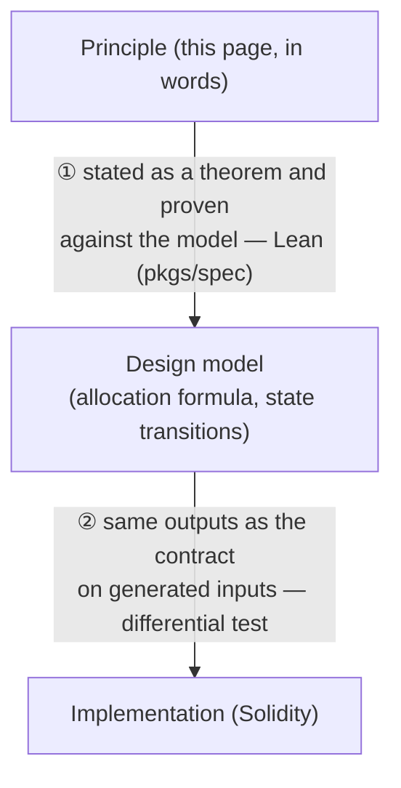

# Protocol overview

This section describes the Toban smart contracts as a protocol: what each contract is for, how it works, why it is built that way, and what it promises. For how to use the app, see [Get started](../getstarted/index.md).

Toban records contributions as **roles** ([Hats Protocol](https://docs.hatsprotocol.xyz/) hats) and **thanks** (ThanksToken). It turns them into reward **splits** ([0xSplits](https://docs.splits.org/)). Toban deploys modules and creators that plug into Hats and 0xSplits. It does not change those audited protocols, and this section covers only Toban's own logic.

## How each module page is organized

1. **Goal**: what the module is for.
2. **Mechanism**: its state, functions, events and links to other contracts, with a diagram.
3. **Rationale**: why it is designed this way, and which alternatives were rejected.
4. **Principles**: what the protocol promises, each with an ID such as `SPL-1`.

## From principle to implementation

A principle is only worth stating if we can show that the contract keeps it. That takes two steps:

1. **Proof.** [`pkgs/spec`](https://github.com/hackdays-io/toban/tree/main/pkgs/spec) models the module's logic in [Lean 4](https://lean-lang.org/). The model uses the same integer rounding as the contract. Each principle is a theorem about that model. The build fails if any proof is missing (`sorry`).
2. **Conformance.** The Lean model is executable. It generates test vectors (inputs and expected outputs), and a Hardhat test checks that the Solidity contract returns exactly the same outputs for them.

### Verification status

Every principle shows its status on two axes:

| Axis | Value | Meaning |
| --- | --- | --- |
| Proof | `proven (Lean)` | A Lean theorem with this ID builds without `sorry`. |
| | — | Not proven yet. |
| Implementation | `fuzzed` | Covered by a differential test against the Lean model on generated inputs. |
| | `tested` | Covered by an example-based contract test tagged with this ID. |
| | — | No test yet. |

### IDs

An ID is `<PREFIX>-<n>`. The prefix names the module (`SPL` = SplitsCreator), and numbers are never reused. The same ID appears in three places, and `scripts/check-spec-ids.mjs` (run by `scripts/verify.sh` in CI) fails if they disagree:

- the Principles table on the module page,
- a `-- SPL-n` comment directly above the Lean theorem,
- `[SPL-n]` in the name of each contract test that checks it.

## Modules

| Module | Spec status |
| --- | --- |
| [SplitsCreator](./modules/splits-creator.md) | Principles proven and fuzzed (pilot) |
| [ThanksToken](./modules/thanks-token.md) | Outline only |
| [HatsTimeFrameModule](./modules/hats-time-frame-module.md) | Outline only |
| [HatsFractionTokenModule](./modules/hats-fraction-token-module.md) | Outline only |
| [BigBang](./modules/bigbang.md) | Outline only |
| [HatsHatCreatorModule](./modules/hats-hat-creator-module.md) | Outline only |
| [ScheduledDistributor](./modules/scheduled-distributor.md) | Outline only |
| [HatsQuestModule](./modules/hats-quest-module.md) | Outline only |

See also: [Architecture](./architecture.md) · [Permission model](./permissions.md) · [Upgrade policy](./upgrades.md) · [Known limitations](./known-limitations.md)
