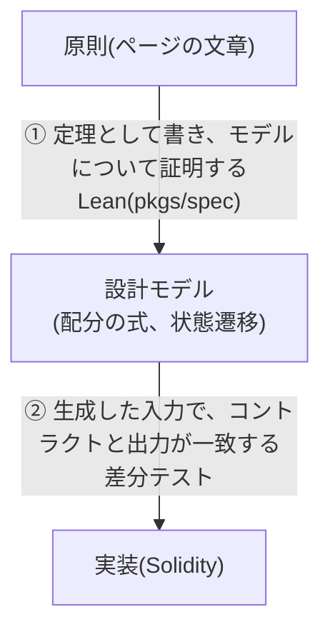

# プロトコルの概要

このセクションでは、Toban のスマートコントラクトをプロトコルとして説明する。各コントラクトが何のためにあり、どう動き、なぜその設計にしたのか、そして何を約束するのかを書く。アプリの使い方は [Toban を始める](../getstarted/index.md)を参照。

Toban は、貢献を**ロール**([Hats Protocol](https://docs.hatsprotocol.xyz/) の hat)と**サンクス**(ThanksToken)として記録し、それを報酬の **split**([0xSplits](https://splits.org/))に変える。Toban がデプロイするのは、Hats と 0xSplits に組み込むモジュールと creator で、監査済みのこの 2 つのプロトコル自体は変更しない。このセクションで扱うのも、Toban 独自のロジックだけである。

## モジュールのページの構成 {#how-each-module-page-is-organized}

1. **目的**: そのモジュールが何のためにあるか。
2. **仕組み**: 状態、関数、イベント、他のコントラクトとの関係。図を添える。
3. **設計の理由**: なぜこの設計にしたか、どの案を採らなかったか。
4. **原則**: プロトコルが約束すること。それぞれに `SPL-1` のような ID を付ける。

## 原則から実装まで {#from-principle-to-implementation}

原則は、コントラクトがそれを守っていると示せて初めて書く意味がある。示すには 2 段階を踏む。

1. **証明。** [`pkgs/spec`](https://github.com/hackdays-io/toban/tree/main/pkgs/spec) で、モジュールのロジックを [Lean 4](https://lean-lang.org/) でモデル化する。モデルの整数の丸めはコントラクトと同じにしてある。各原則は、このモデルについての定理である。証明が欠けている(`sorry` がある)とビルドが失敗する。
2. **実装との一致。** Lean のモデルは実行できる。モデルからテストベクタ(入力と、期待される出力の組)を生成し、Hardhat のテストで、Solidity のコントラクトがそれらの入力に対してまったく同じ出力を返すことを確かめる。

### 検証状態 {#verification-status}

各原則には、2 つの軸で検証状態を示す。表に書く値は `scripts/check-spec-ids.mjs` が機械的に読むので、下の英語の表記のまま書く。

| 軸 | 値 | 意味 |
| --- | --- | --- |
| 証明 | `proven (Lean)` | この ID の Lean の定理が、`sorry` なしでビルドできる。 |
| | — | まだ証明していない。 |
| 実装との一致 | `fuzzed` | 生成した入力で Lean のモデルと突き合わせる差分テストがある。 |
| | `tested` | この ID を名前に付けた、具体例によるコントラクトのテストがある。 |
| | — | テストがまだない。 |

### ID {#ids}

ID は `<接頭辞>-<番号>` の形にする。接頭辞はモジュールを表し(`SPL` は SplitsCreator、`THX` は ThanksToken)、番号は再利用しない。同じ ID を次の 3 か所に書き、食い違っていると `scripts/check-spec-ids.mjs`(CI で `scripts/verify.sh` から実行される)が失敗する。

- モジュールのページの原則の表
- Lean の定理の直前の行の `-- SPL-n` というコメント
- その原則を確かめるコントラクトのテストの名前に入れた `[SPL-n]`

## モジュール {#modules}

| モジュール | 仕様の状態 |
| --- | --- |
| [SplitsCreator](./modules/splits-creator.md) | 原則を証明し、差分テスト済み(パイロット) |
| [ThanksToken](./modules/thanks-token.md) | 原則を証明し、差分テスト済み |
| [HatsTimeFrameModule](./modules/hats-time-frame-module.md) | 枠のみ |
| [HatsFractionTokenModule](./modules/hats-fraction-token-module.md) | 枠のみ |
| [BigBang](./modules/bigbang.md) | 枠のみ |
| [HatsHatCreatorModule](./modules/hats-hat-creator-module.md) | 枠のみ |
| [ScheduledDistributor](./modules/scheduled-distributor.md) | 枠のみ |
| [HatsQuestModule](./modules/hats-quest-module.md) | 枠のみ |

関連ページ: [アーキテクチャ](./architecture.md) · [権限モデル](./permissions.md) · [アップグレード方針](./upgrades.md) · [既知の制約](./known-limitations.md)
