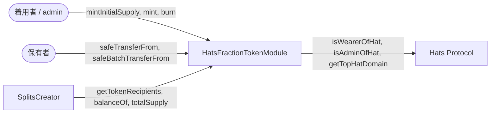

# HatsFractionTokenModule

**ソース:** [`pkgs/contract/contracts/hatsmodules/fractiontoken/HatsFractionTokenModule.sol`](https://github.com/hackdays-io/toban/blob/main/pkgs/contract/contracts/hatsmodules/fractiontoken/HatsFractionTokenModule.sol)
· **モデルと証明:** [`pkgs/spec/Spec/HatsFractionTokenModule/`](https://github.com/hackdays-io/toban/tree/main/pkgs/spec/Spec/HatsFractionTokenModule)
· **差分テスト:** [`pkgs/contract/test/HatsFractionTokenModule.Differential.ts`](https://github.com/hackdays-io/toban/blob/main/pkgs/contract/test/HatsFractionTokenModule.Differential.ts)

## 目的 {#goal}

ロールの着用者が、そのロールの報酬を手伝ってくれた人と分け合えるようにする。着用者は、自分がそのロールで受け取る分を表すトークン(シェア)を持ち、その一部を他人に渡せる。[SplitsCreator](./splits-creator.md) のロール配分では、着用者の取り分が、そのシェアの保有量に比例して保有者に分かれる。

## 仕組み {#mechanism}

HatsFractionTokenModule はワークスペースごとに 1 つある。`BigBang.bigbang` の実行中に、`HatsModuleFactory` がワークスペースの top hat 向けの clone としてデプロイする。初期化のときに top hat のドメイン(hat ID の上位 32 ビット)を `DOMAIN` として記録し、以後はこのドメインに属するロールだけを扱う。初期化の引数は、メタデータの URI と `DEFAULT_TOKEN_SUPPLY`(100 万以下)である。

### 用語 {#terms}

- **着用者**: そのロール(Hats の hat)を着用しているアカウント。
- **シェア**: ロールと着用者の組 1 つにつき 1 種類ある ERC-1155 トークン。トークン ID は `getTokenId(hatId, wearer)` = `keccak256(abi.encodePacked(hatId, wearer))` で決まる。同じロールでも、着用者が違えば別のシェアになる。以下、「着用者のシェア」と書いたら、そのロールでのその着用者のシェアを指す。
- **保有者**: あるシェアを 1 以上持っているアカウント。着用者本人のほか、着用者からシェアを受け取ったアカウントがなる。
- **供給量**: あるシェアの発行済みの総量(ERC1155Supply の `totalSupply(id)`)。mint で増え、burn で減る。
- **受取人一覧**: シェアごとにコントラクトが保存しているアドレスの一覧(`getTokenRecipients(id)`)。最初の mint で着用者が、送金で受け取ったアカウントがまだ一覧にいなければ、そのアカウントが末尾に加わる。一覧から外れることはないので、残高が 0 になったアカウントも残る。ERC-1155 は保有者を列挙できないので、SplitsCreator はこの一覧で保有者を見つける。
- **既定の供給量**: `DEFAULT_TOKEN_SUPPLY`。量を 0 として `mintInitialSupply` を呼んだときに発行する量で、まだ発行していないシェアの見かけの値(下の `balanceOf` / `totalSupply`)にも使う。

### 関数 {#functions}

「着用者か admin」は、そのロールの admin か着用者であること(`_checkValidAction`)を指す。このとき、ロールが `DOMAIN` に属すること、対象の `wearer` がそのロールを着用していることも確かめる。

| 関数 | 呼べる人 | 動作 |
| --- | --- | --- |
| `mintInitialSupply(hatId, wearer, amount)` | ロールの着用者か admin | 着用者の残高が 0 のときだけ、着用者に `amount`(0 なら既定の供給量)を発行し、受取人一覧に着用者を加える。残高があれば `TokenAlreadyMinted` で revert する。 |
| `batchMintInitialSupply(hatIds, wearers, amounts)` | 各ロールの着用者か admin | 配列の長さがそろっているか、全件が上の条件を満たすかを先に確かめてから、1 件ずつ `mintInitialSupply` を実行する。1 件でも失敗すれば全体が revert する。 |
| `mint(hatId, wearer, amount)` | ロールの着用者か admin | 着用者の残高が 0 でなければ、着用者に `amount` を追加で発行する。0 なら `InitialSupplyNotMinted` で revert する。 |
| `burn(hatId, wearer, target, amount)` | ロールの着用者か admin | 着用者のシェアを、`target` の残高から `amount` だけ焼く。`target` は着用者本人でなくてもよい。 |
| `safeTransferFrom(from, to, id, amount, data)` | `from` 本人か、`from` が承認した operator | ERC-1155 の送金。受取人一覧の先頭が `from` で、`amount` が `from` の残高と等しいときは `CannotTransferAllTokens` で revert する。送金後、`to` が一覧になければ加える。 |
| `safeBatchTransferFrom(from, to, ids, amounts, data)` | 同上 | 各 ID について上と同じ確かめをしてから、まとめて送金する。そのあと各 ID の一覧に `to` を加える。 |
| `setApprovalForAll(operator, approved)` | 誰でも | ERC-1155 の承認。 |
| `getTokenRecipients(id)` | 誰でも(view) | 受取人一覧を返す。 |
| `balanceOf(account, wearer, hatId)` | 誰でも(view) | `account` がそのロールを着用していて、着用者のシェアの受取人一覧にいなければ、既定の供給量を返す。それ以外は実際の残高を返す。 |
| `totalSupply(wearer, hatId)` | 誰でも(view) | 着用者が自分のシェアの受取人一覧にいなければ、既定の供給量を返す。いれば供給量を返す。 |

`balanceOf(account, wearer, hatId)` と `totalSupply(wearer, hatId)` は、SplitsCreator が読む値である。まだ発行していないシェアは、着用者が既定の供給量をすべて持っているように見える。ERC-1155 の `balanceOf(account, id)`・`totalSupply(id)`・`totalSupply()` は実際の値を返す。

## 設計の理由 {#rationale}

:::note 人のレビュー待ち
この節は、コードとコメントから読み取れることを書いた案である。
:::

- **シェアは着用者ごとに分ける。** 同じロールに複数の着用者がいても、それぞれが自分のシェアを誰とどれだけ分けるかを決められる。SplitsCreator は、各保有者のスコアをロールの中の全シェアの供給量の合計で割る。
- **まだ発行していないシェアは、既定の供給量で数える。** 着用者が `mintInitialSupply` を呼ぶ前でも、そのロールのロール配分には既定の供給量ぶん加わる。
- **着用者は、送金で自分の残高をすべて手放すことはできない。** コードのコメントによれば、着用者とロールのつながりを保つためである。受取人一覧の先頭(ふつうは最初に発行を受けた着用者。既知の制約のとおり、そうでない場合がある)だけに課す制限で、ほかの保有者(クエストのエスクローのような中継のコントラクトを含む)は全額を送れる。

## 原則 {#principles}

各原則の ID は、この表、Lean の定理([`Theorems.lean`](https://github.com/hackdays-io/toban/blob/main/pkgs/spec/Spec/HatsFractionTokenModule/Theorems.lean) の `-- HFT-n`)、コントラクトのテスト名(`[HFT-n]`)で同じものを使う。3 か所が一致しているかは `scripts/check-spec-ids.mjs` が確かめる。「証明」と「実装との一致」の 2 列の意味は、[概要](../index.md#verification-status)に書いてある。HFT-1・2・4・7 は、モジュールを初期化してから、任意の順で任意の取引(revert したものは何も変えない)を実行したあとの状態についての原則である。

| ID | 原則 | 証明 | 実装との一致 |
| --- | --- | --- | --- |
| `HFT-1` | シェアの供給量は、着用者の残高と、受取人一覧にいる着用者以外の各アカウントの残高を足した値にちょうど等しい。 | proven (Lean) | fuzzed |
| `HFT-2` | シェアを 1 以上持っているアカウントは、必ずそのシェアの受取人一覧にいる。 | proven (Lean) | fuzzed |
| `HFT-3` | 成功した取引は、受取人一覧の末尾に加えるだけで、一覧の要素を消したり並べ替えたりしない。 | proven (Lean) | fuzzed |
| `HFT-4` | 受取人一覧に、着用者以外のアカウントは多くても 1 回しか現れない。 | proven (Lean) | fuzzed |
| `HFT-5` | 送金(`safeTransferFrom`、`safeBatchTransferFrom`)は、どのシェアの供給量も、全シェアの供給量の合計も変えない。 | proven (Lean) | fuzzed |
| `HFT-6` | 受取人一覧の先頭のアカウントが、`safeTransferFrom` でそのシェアの残高をちょうど全部送ろうとすると、`CannotTransferAllTokens` で revert する。 | proven (Lean) | fuzzed, tested |
| `HFT-7` | 着用者が自分のシェアの受取人一覧にいるとき、`totalSupply(wearer, hatId)` は、着用者と一覧の他のアカウントの `balanceOf(·, wearer, hatId)` の合計に等しい。いないとき、`totalSupply(wearer, hatId)` は既定の供給量で、着用者がロールを着用していれば `balanceOf(wearer, wearer, hatId)` も既定の供給量である。 | proven (Lean) | fuzzed |
| `HFT-8` | 取引が成功するなら、その結果の状態は上限のない自然数で計算した結果とまったく同じである。overflow(Panic 0x11)以外の理由で revert するなら、上限のない計算も同じ理由で revert する。 | proven (Lean) | fuzzed |

HFT-1・2・4 を合わせると、受取人一覧の各アカウントを 1 回ずつ数えれば、保有者全員の残高の合計が供給量になる。SplitsCreator が保有者を数えるときに頼っているのは、この性質である。

**Lean のモデルは 2 つある。** 状態(残高、受取人一覧、供給量、承認)と各取引による変化を、上限のない自然数で計算するモデル([`Model.lean`](https://github.com/hackdays-io/toban/blob/main/pkgs/spec/Spec/HatsFractionTokenModule/Model.lean))と、Solidity 0.8 と同じく残高・供給量への加算が 2^256 以上になると overflow で revert するモデル([`Contract.lean`](https://github.com/hackdays-io/toban/blob/main/pkgs/spec/Spec/HatsFractionTokenModule/Contract.lean))である。2 つは加算の仕方だけが違う同じ定義で、確かめの順序も OpenZeppelin 5.3 の ERC1155 / ERC1155Supply を含めてコントラクトと同じにしてあるので、revert の理由(カスタムエラーとその引数、panic のコード)まで一致する。HFT-1〜7 は後者のモデルについての定理で、HFT-8 によって前者で証明したことを後者に移している。Hats Protocol が返す値(誰がどのロールを着用・管理しているか)は、モデルへの入力として扱う。

**ここでの「fuzzed」が確かめていること。** `pnpm spec vectors`(`lake exe gen-vectors`)は、手書きの取引列 45 件と、シードを固定した乱数の取引列 120 件で uint256 のモデルを実行する。乱数の取引は、約 45% の確率で、その時点で実際に保有されている残高を送金・焼却するか、発行済みのシェアに追加で発行するものにしてある。差分テストは、Hats Protocol を入力どおりに答える mock に置き換えたうえで、各取引列を新しいモジュールの clone に実行する。そして、各取引の成否と revert の理由がモデルと一致すること、最後に、触れたすべてのシェアの受取人一覧・供給量・実際の残高・`balanceOf(account, wearer, hatId)`・`totalSupply(wearer, hatId)` と全シェアの供給量の合計がモデルと一致することを求める。

## 既知の制約 {#known-limitations}

- **量 0 の送金で、誰でも任意のシェアの受取人一覧にアドレスを加えられる。** ERC-1155 は量 0 の送金を許し、残高 0 のアカウントでも自分から量 0 を送れる。このモジュールは送金のたびに受け取り側を一覧に加えるので、発行前のシェアにも加えられる。その結果、次のことが起きる(いずれも差分テストのベクタに含めて、モデルどおりに起きることを確かめている)。
  - 着用者が発行を受ける前に他のアドレスが加えられると、着用者は一覧の先頭でなくなり、HFT-6 の制限を受けずに残高をすべて送れる。
  - 同じ状態で SplitsCreator の `preview` / `create` を実行すると Panic 0x32(配列の範囲外)で revert する。SplitsCreator は配列の長さを受取人一覧の長さで決めるが、着用者は一覧にいなくても 1 件として書き込むので、書き込む件数が配列の長さを 1 超える(SplitsCreator の mock を使った確認)。
  - 発行前に着用者自身が一覧に加えられると、`totalSupply(wearer, hatId)` と `balanceOf(wearer, wearer, hatId)` は既定の供給量から 0 に変わる。そのロールの着用者全員がこうなると、SplitsCreator はロールの供給量の合計 0 で割って revert する(SPL-5)。
  - 一覧は短くならないので、SplitsCreator が一覧をたどるループの回数とガスは、加えられたアドレスの数だけ増える。
- **着用者は受取人一覧に 2 回以上現れることがある。** 着用者の残高が 0 になったあと(焼却された、同じ ID を繰り返す一括送金で全部送った、既定の供給量が 0 で量 0 を指定した、など)に `mintInitialSupply` をもう一度呼ぶと、着用者がもう一度一覧に加わる。このとき SplitsCreator の `preview` は、末尾にアドレス 0・配分 0 のエントリーを余分に返す(SplitsCreator の mock を使った確認)。HFT-4 が約束するのは、着用者以外のアカウントについてだけである。
- **`safeBatchTransferFrom` で同じ ID を繰り返すと、先頭の着用者も残高を 0 にできる。** 全額送金の確かめは ID ごとに送金前の残高と比べるので、たとえば残高 10000 を 9999 と 1 に分けて 1 回で送ると通る。HFT-6 は `safeTransferFrom` についての原則である。
- **ロールの着用者は、同じロールの他の着用者のシェアも発行・焼却できる。** `mintInitialSupply`・`mint`・`burn` の権限の確かめは、呼び出し元がそのロールの admin か着用者かだけを見る。`burn` は、着用者のシェアを持っている任意のアカウントの残高を焼ける。
- **`balanceOf(account, wearer, hatId)` の既定の値は、着用者以外にも返る。** そのロールを着用しているが受取人一覧にいないアカウントには、他の着用者のシェアについても既定の供給量を返す。SplitsCreator は着用者本人と一覧のアカウントについてしか呼ばないので、配分には影響しない。
- **発行量に上限はない。** `MAX_SUPPLY_PER_ROLE_USER`(100 万)が制限するのは初期化のときの `DEFAULT_TOKEN_SUPPLY` だけである。`mintInitialSupply` と `mint` に量を指定すれば、ロールの admin か着用者は uint256 の上限まで発行できる(差分テストには 2^256 − 1 の発行と、その先の overflow の入力がある)。
- **モデルに入れていないもの。** 受け取り側は ERC-1155 のトークンを必ず受け入れる(コントラクトなら `onERC1155Received` が成功する)と仮定している。受け取りを拒むコントラクトへの送金、`multicall`、初期化(`DEFAULT_TOKEN_SUPPLY` が 100 万を超えたときの `TokenSupplyExceedsMax`)はモデルにも差分テストにもない。
- **トークン ID は keccak256 の衝突がないことを前提にしている。** モデルでは、トークン ID をロールと着用者の組そのものとして扱う。
- 受取人一覧から外れることはないので、一覧には残高 0 のアカウントも残る。SplitsCreator は、これらのアカウントもエントリーにする(クエストのエスクローがなければ配分は 0)。
