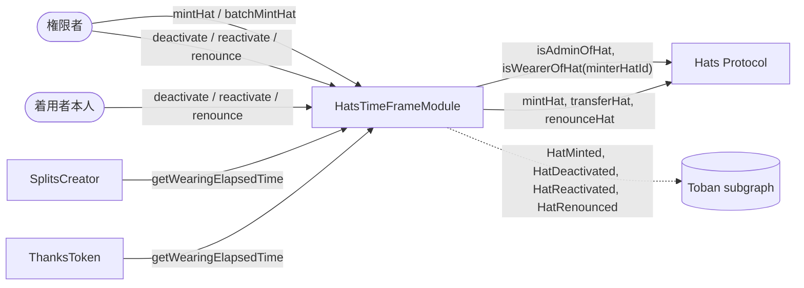

# HatsTimeFrameModule

**ソース:** [`pkgs/contract/contracts/hatsmodules/timeframe/HatsTimeFrameModule.sol`](https://github.com/hackdays-io/toban/blob/main/pkgs/contract/contracts/hatsmodules/timeframe/HatsTimeFrameModule.sol)
· **モデルと証明:** [`pkgs/spec/Spec/HatsTimeFrameModule/`](https://github.com/hackdays-io/toban/tree/main/pkgs/spec/Spec/HatsTimeFrameModule)
· **差分テスト:** [`pkgs/contract/test/HatsTimeFrameModule.Differential.ts`](https://github.com/hackdays-io/toban/blob/main/pkgs/contract/test/HatsTimeFrameModule.Differential.ts)

## 目的 {#goal}

各メンバーがロールをどれだけの期間担ったかを、休んでいた期間を除いて記録する。この記録が着用時間になり、[SplitsCreator](./splits-creator.md) はそれを使って、長く担った人ほど多く受け取る配分を作る(SPL-7)。

## 仕組み {#mechanism}

HatsTimeFrameModule はワークスペースごとに 1 つある。`BigBang.bigbang` の実行中に、`HatsModuleFactory` が Hats のモジュールとしてデプロイする。初期化データは、BigBang が作る **minter hat** の ID(`minterHatId`)である。BigBang はモジュールに hatter hat を mint するので、モジュールは hatter hat の下にあるロールの hat を mint・移動できる。

### 用語 {#terms}

- **権限者**: minter hat の admin か着用者である account。`hasAuthority(account)` が true を返す。
- **着用者**: ある hat(ロール)について、このモジュールに記録がある account。
- **着用期間**: 着用者がロールを担っていた期間。`mintHat` で始まり、`deactivate` で終わる。`reactivate` で新しい期間が始まる。`renounce` すると、それまでの期間の記録はすべて消える。終わっていない期間(今の期間)は、現在まで続いているものとして数える。
- **開始時刻**: `mintHat` / `batchMintHat` の `time` 引数。最初の着用期間はこの時刻に始まる。0 を渡すとそのブロックの時刻になる。過去の時刻も、未来の時刻も渡せる。
- **中断・再開・辞退**: それぞれ `deactivate`・`reactivate`・`renounce` を呼ぶこと。
- **着用時間**: `getWearingElapsedTime(wearer, hatId)` が返す秒数。
- **revert**: 呼び出しが失敗し、何も変わらないこと。失敗の理由は、`require` に書かれたメッセージ(`Not authorized` など)か、Solidity が自動で起こす panic である。**Panic 0x11** は、計算の結果が 0 を下回るか、uint256(Solidity の整数型。最大値は 2^256 − 1)に収まらない(**overflow**)ときの panic である。

### 状態 {#state}

hat と着用者の組ごとに、次の 4 つの値を持つ。hat が違えば記録は互いに影響しない。

| 変数 | 意味 |
| --- | --- |
| `woreTime` | 今の(または最後の)着用期間が始まった時刻。0 なら記録がない。 |
| `totalActiveTime` | 終わった着用期間の長さの合計。 |
| `isActive` | 今、着用期間の途中か。 |
| `deactivatedTime` | 最後に中断した時刻。記録のためだけにあり、計算には使わない。 |

着用時間は、中断中なら `totalActiveTime`、着用期間の途中なら `totalActiveTime + (block.timestamp - woreTime)` である。期間の一覧は持たず、終わった期間の合計と今の期間の開始時刻だけを持つ。

### 関数 {#functions}

| 関数 | 呼べる人 | 動作 |
| --- | --- | --- |
| `mintHat(hatId, wearer, time)` | 権限者 | 記録のない着用者に、開始時刻 `time` で最初の着用期間を始め、Hats で hat を mint する。記録があれば `Hat already minted` で revert する。 |
| `batchMintHat(hatId, wearers, times)` | 権限者 | 最大 100 人の `mintHat`。先に全員を確かめる(空配列、長さの不一致、101 人以上、`address(0)`、記録あり)。同じ人が 2 回あると、2 回目で revert する。どれか 1 つでも失敗すれば全体が revert する。 |
| `deactivate(hatId, wearer)` | 権限者、着用者本人 | 今の着用期間を終え、その長さを `totalActiveTime` に足す。中断中なら `Hat is already inactive` で revert する。 |
| `reactivate(hatId, wearer)` | 権限者、着用者本人 | 新しい着用期間を今の時刻から始める。期間の途中なら `Hat is already active` で revert する。 |
| `renounce(hatId, wearer)` | 権限者、着用者本人 | Hats で hat をモジュールに移してから手放し、4 つの値をすべて 0 に戻す。 |
| `getWearingElapsedTime(wearer, hatId)` | 誰でも(view) | 着用時間を返す。`woreTime` がまだ来ていない(未来の開始時刻で mint した)ときは `Invalid wore time` で revert する。 |
| `getWoreTime(wearer, hatId)` | 誰でも(view) | `woreTime` を返す。再開すると再開した時刻に変わるので、最初に mint した時刻とは限らない。 |

## 設計の理由 {#rationale}

- **中断した期間は数えない。** 休んでいる間も着用時間が増えると、実際には担っていない人の取り分が増え続ける。中断と再開は本人もできるので、休むときに管理者の手を借りる必要がない。
- **期間の一覧ではなく、合計と今の期間の開始時刻だけを持つ。** 中断と再開を何度くり返しても、保存する値と計算の手間は増えない。それでも、着用時間は着用期間の長さの合計とちょうど等しくなる(HTF-1)。
- **開始時刻を指定できる。** Toban を使い始める前からロールを担っていた人を、実際に始めた時刻で登録できるようにするためである(`batchMintHat` で CSV から一括登録する用途)。
- **記録を始められるのは権限者だけ。** 着用時間はそのまま報酬の配分に効くので、誰の記録を始めるかは minter hat で絞る。一方で、自分の記録を止める・再開する・手放すことは本人にもできる。
- **辞退すると記録を消す。** もう一度 mint されたときは、新しい着用者として 0 から数える。

## 原則 {#principles}

各原則の ID は、この表、Lean の定理([`Theorems.lean`](https://github.com/hackdays-io/toban/blob/main/pkgs/spec/Spec/HatsTimeFrameModule/Theorems.lean) の `-- HTF-n`)、コントラクトのテスト名(`[HTF-n]`)で同じものを使う。3 か所が一致しているかは `scripts/check-spec-ids.mjs` が確かめる。「証明」と「実装との一致」の 2 列の意味は、[概要](../index.md#verification-status)に書いてある。

原則は、モジュールが空の状態から、0 より大きく 2^256 未満で、減ることのないブロック時刻での呼び出しを任意の順に重ねて到達する、すべての状態について述べている。誰が権限者かは、呼び出しごとに変わってよい(minter hat の受け渡しで変わるため)。revert した呼び出しは何も変えないので、時間が進んだだけとして扱う。

| ID | 原則 | 証明 | 実装との一致 |
| --- | --- | --- | --- |
| `HTF-1` | 着用時間は、その着用者の着用期間の長さの合計とちょうど等しい。中断していた期間は数えない。 | proven (Lean) | fuzzed, tested |
| `HTF-2` | 時間が進んでも、着用時間は減らない。中断している間は変わらない。 | proven (Lean) | fuzzed, tested |
| `HTF-3` | 着用時間を減らす操作は辞退だけで、辞退した着用者の着用時間は 0 に戻る。ほかの操作は、どの着用者の着用時間も減らさない。 | proven (Lean) | fuzzed |
| `HTF-4` | 着用時間は、最初の着用期間が始まってから今までの時間を超えない。 | proven (Lean) | fuzzed |
| `HTF-5` | `getWearingElapsedTime` が revert するのは、未来の開始時刻で mint され、その時刻がまだ来ていないときだけである。`deactivate` が Panic 0x11 で revert するのも、この場合だけである。 | proven (Lean) | fuzzed |
| `HTF-6` | 着用者の記録を変えられるのは権限者だけである。ただし着用者本人は、自分の記録を中断・再開・辞退できる。 | proven (Lean) | fuzzed, tested |
| `HTF-7` | uint256 の計算は overflow しない。どの呼び出しも、上限のない自然数で計算した結果(revert の理由を含む)とまったく同じになる。 | proven (Lean) | fuzzed |

**Lean のモデルは 2 つある。** 上限のない自然数で計算するモデル([`Model.lean`](https://github.com/hackdays-io/toban/blob/main/pkgs/spec/Spec/HatsTimeFrameModule/Model.lean))と、Solidity 0.8 と同じく足し算の結果が 2^256 以上になると Panic 0x11 で revert するモデル([`Contract.lean`](https://github.com/hackdays-io/toban/blob/main/pkgs/spec/Spec/HatsTimeFrameModule/Contract.lean))である。どちらも、`require` をコントラクトと同じ順に確かめるので、revert の理由まで一致する。原則はすべて後者についての定理である。証明では、着用期間の一覧を別に持つ抽象的な記録を用意し、到達しうるどの状態でもコントラクトの 4 つの値がその記録と食い違わないこと(着用期間が重ならず、時刻の順に並ぶことも含む)を示している。HTF-1〜5 と HTF-7 はここから導いている。

**ここでの「fuzzed」が確かめていること。** `lake exe gen-vectors` は、手書きの呼び出し列 38 件と、シードを固定した乱数の呼び出し列 100 件(合わせて 1,354 ステップ)で uint256 のモデルを実行する。手書きの列には、未来の開始時刻、uint256 の最大値の開始時刻、`batchMintHat` の 100 人と 101 人、確かめる順序が結果を変える入力などを含めてある。差分テストは、各ケースで新しいモジュールをデプロイし、各ステップをそのブロック時刻で実行する。そのうえで、呼び出しが成功したか(失敗したなら、どの `require` の理由または panic か)と、4 人の account それぞれについての 4 つの値と着用時間が、モデルと一致することを求める。Hats は、権限の確認だけを vector のとおりに答え、hat の移動は何もせずに成功する mock に置き換えている。Hats 自身の確認(すでに hat を持っている人への mint など)は、このテストの範囲外である。

## 既知の制約 {#known-limitations}

- **未来の開始時刻で mint できる。** その時刻が来るまで、`getWearingElapsedTime` は revert し、`deactivate` は Panic 0x11 で revert する(HTF-5)。SplitsCreator はこの関数を呼ぶので、そのロールを含む `preview` / `create` も revert する。ThanksToken も、そのロールのシェアを持つ人が mint できる量を計算するときにこの関数を呼ぶ。`renounce` は revert しないので、記録を消してから正しい時刻で mint し直せる。
- **mint されていない account でも `reactivate` できる。** 記録がない account が自分自身について `reactivate` を呼ぶと(権限者も呼べる)、hat を持っていなくても、その時刻から着用期間が始まり着用時間が増える。また `woreTime` が 0 でなくなるので、その後の `mintHat` は `Hat already minted` で revert する。記録を消す `renounce` は Hats の `transferHat` を呼ぶので、hat を持っていない account では revert する。その account を含む `batchMintHat` も、事前の確認で `Hat already minted` になり、全体が revert する。
- **Hats 側の変化は反映されない。** hat がこのモジュールを通さずに外されたり(eligibility や toggle、Hats の `transferHat` など)、渡されたりしても、モジュールの記録は変わらない。着用時間は、モジュールの記録だけから決まる。
- **immutable なロールの hat では、記録を消せない。** `renounce` は Hats の `transferHat` を呼ぶが、Hats は immutable な hat の移動を `Immutable` で拒む。フロントエンドが作るロールの hat は mutable だが、コントラクトは immutable な hat も作れる。
- **`renounce` は権限者も呼べる。** 名前は「辞退」だが、権限者が着用者の hat を外し、記録を消すことにも使える。
- **ブロック時刻が同じ呼び出しは、差分テストで確かめていない。** テストのチェーンはブロックごとに時刻を進めるので、各ケースのステップは 1 秒以上ずつ離してある。Lean の証明は、同じ時刻の呼び出しも含めている。
