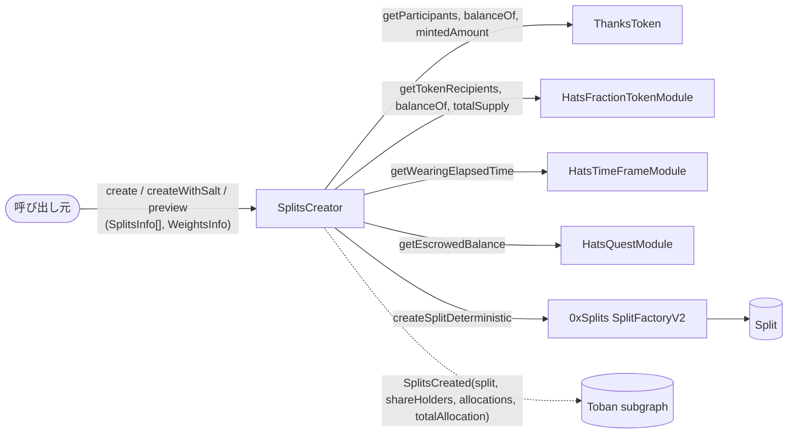

# SplitsCreator

**ソース:** [`pkgs/contract/contracts/splitscreator/SplitsCreator.sol`](https://github.com/hackdays-io/toban/blob/main/pkgs/contract/contracts/splitscreator/SplitsCreator.sol)
· **モデルと証明:** [`pkgs/spec/Spec/SplitsCreator/`](https://github.com/hackdays-io/toban/tree/main/pkgs/spec/Spec/SplitsCreator)
· **差分テスト:** [`pkgs/contract/test/SplitsCreator.Differential.ts`](https://github.com/hackdays-io/toban/blob/main/pkgs/contract/test/SplitsCreator.Differential.ts)

## 目的 {#goal}

ワークスペースに記録されたこと(誰がどのロールをどれだけの期間担ったか、そのロールの報酬を誰と分け合ったか、互いにどれだけ感謝を送ったか)から、誰でも検算できる報酬の分配を作る。SplitsCreator は配分を計算し、その配分で [0xSplits](https://splits.org/) V2 の split コントラクトをデプロイする([開発者向けドキュメント](https://docs.splits.org/))。SplitsCreator 自身は資金を保持も移動もしない。

## 仕組み {#mechanism}

SplitsCreator はワークスペースごとに 1 つある。`BigBang.bigbang` の実行中に、`SplitsCreatorFactory` が最小限の clone としてデプロイする。依存先のコントラクト(Hats、Splits の factory、`HatsTimeFrameModule`、`HatsFractionTokenModule`、`ThanksToken`、`HatsQuestModule`)は、clone の immutable な引数として持つ。

### 関数 {#functions}

| 関数 | 呼べる人 | 動作 |
| --- | --- | --- |
| `preview(splitsInfo, weightsInfo)` | 誰でも(view) | `(shareHolders, allocations, totalAllocation)` を返す。 |
| `create(splitsInfo, weightsInfo)` | 誰でも | 同じ計算をしてから split をデプロイする。salt は `keccak256(abi.encode(splitsInfo))`。受取人が 2 人未満なら revert する。`SplitsCreated` を emit する。 |
| `createWithSalt(splitsInfo, weightsInfo, salt)` | 誰でも | `create` と同じだが、salt は `keccak256(abi.encode(msg.sender, salt))`。split のアドレスを事前に知る必要がある `ScheduledDistributor` が使う。`msg.sender` を混ぜることで、他人が同じアドレスに先にデプロイできないようにしている。 |

ロール(`hatId`)、着用者、ロールの倍率(`multiplierTop / multiplierBottom`)は、呼び出し元が指定する。4 つの重み(`roleWeight`、`thanksTokenWeight`、`thanksTokenReceivedWeight`、`thanksTokenSentWeight`)も呼び出し元が指定する。それ以外の値はすべてオンチェーンから読む。

### 配分の式 {#the-allocation-formula}

$P = 10^9$(`PRECISION`)とする。`/` はすべて切り捨ての整数除算で、ここに書いた順に計算する。

**サンクス側。** ThanksToken の参加者 $p$ には、残高 $b_p$ と mint 量 $m_p$ がある。残高は、受け取ったサンクスから他人に送金した分を引いた保有量である(ThanksToken は送金できる ERC-20 のため)。mint 量は、送ったサンクスの量である。$B = \sum b_p$、$M = \sum m_p$ とし、受け取りと送りの重みを $r$、$s$ とする。$B > 0$ かつ $M > 0$ なら、各参加者のスコアは次のとおり。

$$
t_p = \left(\frac{r \cdot b_p \cdot P}{B} + \frac{s \cdot m_p \cdot P}{M}\right) \Big/ (r + s)
$$

そうでなければ、全員のスコアは 0 になる。

**ロール側。** ロール $R$ の倍率は $\mu_R = \lfloor top / bottom \rfloor$ である。各着用者 $w$ はシェアトークンを持ち、その保有者は着用者本人と、着用者がシェアの一部を渡した相手である。保有者 $h$ の残高 $e_h$ には、クエストのエスクローとして預けている分を足し戻す。着用者の時間倍率は $\tau_w = \lfloor\sqrt{\text{着用秒数}}\rfloor$ で、ワークスペースに time frame モジュールがなければ 1 とする。ロールのシェアトークンの供給量の合計を $S_R$ とすると、保有者のスコアは次のとおり。

$$
q_h = \frac{e_h \cdot \mu_R \cdot \tau_w \cdot P}{S_R}
$$

**両側の合成。** サンクス側とロール側の重みを $W_t$、$W_r$ とする。重みとスコアの合計 $T$ がどちらも 0 でない側だけが配分に加わり、その側の各エントリーは次の値になる。

$$
\text{allocation} = \frac{x \cdot W \cdot P}{T} \Big/ (W_t + W_r)
$$

並び順は、サンクス側のエントリーが先で、参加者の順に並ぶ。続いてロール側のエントリーが `SplitsInfo` の順に、着用者本人、その着用者の他の保有者の順で並ぶ。`totalAllocation` はすべての配分の合計である。0xSplits は各受取人に、資金の `allocation / totalAllocation` を支払う。同じアカウントが複数のエントリーに現れたら、エントリーごとに支払われる。

## 設計の理由 {#rationale}

- **独立した 2 つの側を、重みで混ぜる。** ロールにもとづく報酬とサンクスにもとづく報酬は、別のものを測っている。前者は継続的な責任を、後者は目に見える手助けを測る。それぞれの側を $P$ に正規化してから混ぜるので、ワークスペースはトークンの量に関係なく、2 つの数で比率を決められる。素点をそのまま足し合わせる案は採らなかった。片方の単位(トークンの wei と、シェア × √秒)がもう片方を圧倒してしまうためだ。
- **着用時間は √ で数える。** 時間は報酬に反映したいが、早く参加したことが分配をいつまでも決めてしまうのは避けたい。平方根を使うと、最初の数か月が最も重く数えられる。それでも、長く担った人の取り分が短い人より少なくなることはない(SPL-7)。
- **0 の側は revert せずに外す。** できたばかりのワークスペースでは、サンクスがまだないことが多い。それで分配全体が revert すると、`ScheduledDistributor.execute` は資金を回収する処理に移ってしまう。その側を外した結果は、その側にエントリーがまったくなかった場合とまったく同じになる(SPL-4)。もう一方の側の受取人どうしの比率は、切り捨ての誤差を除いて変わらない。
- **作成時に計算し、そこで固定する。** 配分は変更できない split に固定されるので、`SplitsCreated` イベントとそのブロックのチェーンの状態から検算できる。引き出しのときに計算する案は採らなかった。合意したあとで結果が変わってしまうためだ。
- **誰でも作成できる。** split を作っても資金は動かない。split が意味を持つのは誰かが資金を送ったときだけなので、どの split に支払うかは支払う側(`ScheduledDistributor` やフロントエンドなど)が決める。

## 原則 {#principles}

各原則の ID は、この表、Lean の定理([`Theorems.lean`](https://github.com/hackdays-io/toban/blob/main/pkgs/spec/Spec/SplitsCreator/Theorems.lean) の `-- SPL-n`)、コントラクトのテスト名(`[SPL-n]`)で同じものを使う。3 か所が一致しているかは `scripts/check-spec-ids.mjs` が確かめる。「証明」と「実装との一致」の 2 列の意味は、[概要](../index.md#verification-status)に書いてある。

| ID | 原則 | 証明 | 実装との一致 |
| --- | --- | --- | --- |
| `SPL-1` | `totalAllocation` は `allocations` の合計とちょうど等しく、受取人 1 人につき配分が 1 つある。 | proven (Lean) | fuzzed |
| `SPL-2` | 各側が受け取るのは、多くてもその重みの割合ぶんの $P$ までである。サンクス側は $P \cdot W_t/(W_t+W_r)$ 以下、ロール側は $P \cdot W_r/(W_t+W_r)$ 以下になる。 | proven (Lean) | fuzzed |
| `SPL-3` | 丸めで値が増えることはない。`totalAllocation` ≤ $P$ である。 | proven (Lean) | fuzzed |
| `SPL-4` | 重みが 0 の側、またはスコアがすべて 0 の側には受取人がいないので、その側の合計 0 で割ることは起きない。結果は、その側にエントリーがまったくなかった場合とまったく同じになる。 | proven (Lean) | fuzzed, tested |
| `SPL-5` | `preview` が 0 除算(Panic 0x12)で revert するのは、次の 3 つのどれかに当たるときだけである。サンクスが保有も送付もされている($B > 0$ かつ $M > 0$)のに `received + sent` の重みが 0 のとき、`multiplierBottom` が 0 のロールがあるとき、着用者がいるのにシェアの供給量の合計が 0 のロールがあるとき。この 3 つのどれかに当たれば、必ず revert する(先に overflow が起きれば Panic 0x11 になる)。 | proven (Lean) | fuzzed |
| `SPL-6` | サンクス側では、ThanksToken の保有量と送った量がどちらも他の参加者以上である参加者は、その参加者より少なく受け取ることがない。 | proven (Lean) | fuzzed |
| `SPL-7` | 同じロールの中では、シェアを他の保有者以上に持ち、そのシェアの着用者のロール着用期間も他の保有者の着用者以上である保有者は、その保有者より少なく受け取ることがない。時間は ⌊√秒⌋ で数える。 | proven (Lean) | fuzzed |
| `SPL-8` | `preview` が値を返すなら、それは上限のない自然数で計算した結果とまったく同じである。また、0 除算で revert するのは上限のない計算も 0 除算になるときだけで、上限のない計算が 0 除算になるときは必ず revert する。 | proven (Lean) | fuzzed |

**Lean のモデルは 2 つある。** 原則を証明しやすいように、上限のない自然数で配分を計算するモデル([`Model.lean`](https://github.com/hackdays-io/toban/blob/main/pkgs/spec/Spec/SplitsCreator/Model.lean))と、Solidity 0.8 と同じく掛け算・足し算の結果が 2^256 以上になると overflow で revert するモデル([`Contract.lean`](https://github.com/hackdays-io/toban/blob/main/pkgs/spec/Spec/SplitsCreator/Contract.lean))である。後者は演算の順序もコントラクトと同じなので、どの panic で revert するかまで一致する。SPL-1・3・5・8 は後者についての定理で、SPL-2・4・6・7 は両者に共通する配分の式についての定理である。後者のモデルが revert するのは 0 除算と overflow の 2 通りだけなので、SPL-5 の 3 つに当たらない revert は、すべて overflow(Panic 0x11)である。

**ここでの「fuzzed」が確かめていること。** Lean のモデルは実行できる。`lake exe gen-vectors` は、手書きの境界ケース 34 件と、シードを固定した乱数の入力 150 件で uint256 のモデルを実行する。境界ケースには、overflow する入力と、overflow する直前の入力も含めてある。差分テストは、それぞれの入力をデータ用の mock を通して実際のコントラクトに与え、受取人・配分・合計がモデルと一致すること、モデルが revert する入力ではコントラクトも同じ panic で revert することを求める。出力が一致するので、モデルについて証明した原則は、これらの入力ではコントラクトでも成り立つ。モデルは、FractionToken モジュールが受取人の一覧をどう作るかは扱っていない([既知の制約](../known-limitations.md)を参照)。

## 既知の制約 {#known-limitations}

- `multiplierTop / multiplierBottom` は、使う前に切り捨てられる。3/2 は 1 として、1/2 は 0 として数えられ、0 になったロールは配分から消える。
- サンクスが保有も送付もされている($B > 0$ かつ $M > 0$)とき、`received + sent` が 0 だと `preview` と `create` は revert する。`thanksTokenWeight` が 0 でも revert する(SPL-5)。
- 残高は ThanksToken の現在の保有量である。受け取ったあとで他人に送金したサンクスは、その参加者の分としては数えない。
- 片方の側が外れたとき(SPL-4)も、もう一方の側には $W/(W_t+W_r)$ が掛かるので、`totalAllocation` は $P$ より小さくなる。0xSplits は `totalAllocation` に対する割合で支払うので、受取人の取り分は切り捨ての誤差を除いて変わらない。
- `PRECISION` はコード上 `10e8` と書かれており、値は $10^9$ である。
- 同じアカウントは、エントリーをまたいでまとめられない。サンクス側に 1 回、保有しているロールのシェアごとに 1 回ずつ現れうる。
