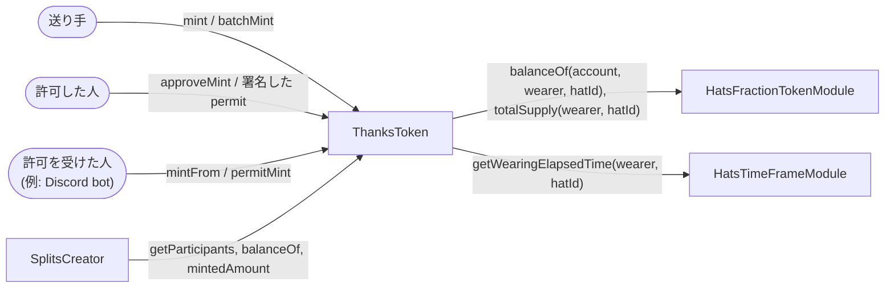

# ThanksToken

**ソース:** [`pkgs/contract/contracts/thankstoken/ThanksToken.sol`](https://github.com/hackdays-io/toban/blob/main/pkgs/contract/contracts/thankstoken/ThanksToken.sol)
· **モデルと証明:** [`pkgs/spec/Spec/ThanksToken/`](https://github.com/hackdays-io/toban/tree/main/pkgs/spec/Spec/ThanksToken)
· **差分テスト:** [`pkgs/contract/test/ThanksToken.Differential.ts`](https://github.com/hackdays-io/toban/blob/main/pkgs/contract/test/ThanksToken.Differential.ts)

## 目的 {#goal}

ワークスペースのメンバーどうしで、手助けへの感謝をサンクス(アシストクレジット)として送り合えるようにする。サンクスは送り手が新しく mint して相手に渡す ERC-20 トークンで、送り手が mint できる量には上限がある。上限は、送り手がどのロールのシェアをどれだけ持ち、そのロールがどれだけの期間担われてきたかと、送り手が今保有しているサンクスの量から決まる。記録された受け取りと送付の量は、[SplitsCreator](./splits-creator.md) のサンクス配分の入力になる。

## 仕組み {#mechanism}

ThanksToken はワークスペースごとに 1 つある。`BigBang.bigbang` の実行中に、`ThanksTokenFactory` が最小限の clone としてデプロイする。ワークスペースの owner(`bigbang` の `_owner`)、`HatsFractionTokenModule`、`HatsTimeFrameModule` のアドレスは、clone の immutable な引数として持つ。

### 用語 {#terms}

原則の表で使う言葉を、先に定義しておく。

- **mint した人**: `mint` と `batchMint` では呼び出した人、`mintFrom` では許可を出した人(`from`)。サンクスの送り手として記録されるのはこの人で、`mintFrom` を実際に呼んだ bot などではない。
- **上限**: mint した人がそれまでに mint してよい量の合計。下の式で決まる。
- **mint できる量**(`mintableAmount`): 上限から、すでに mint した量を引いた残り。0 より小さくはならない。
- **mint した量**(`mintedAmount`): その人が mint した人として mint した量の合計。
- **参加者**(`getParticipants`): サンクスを mint した人と、mint で受け取った人の一覧。
- **許可量**(`mintAllowance(owner, spender)`): `owner` の代わりに `spender` が `mintFrom` で mint してよい量。ERC-20 の `allowance` とは別に管理する。
- **permit**: `owner` が許可量の設定を EIP-712 で署名したもの。誰が送信しても、`permitMint` で許可量を設定できる。
- **nonce**(`mintNonces(owner)`): `owner` が次に署名する permit に入れる通し番号。permit が使われるたびに 1 増える。
- **`totalSupply`**: ERC-20 の発行済みの総量。mint で増え、送金では変わらない。
- **overflow(Panic 0x11)**: 計算の結果が uint256 の上限($2^{256}-1$)を超えたときに、Solidity 0.8 が呼び出し全体を取り消すこと。
- **上限のない自然数で計算したモデル**: 同じ処理を、数の大きさに上限を設けずに Lean で書いたもの。原則はまずこのモデルについて証明する(表の下の「Lean のモデル」を参照)。

### 関数 {#functions}

| 関数 | 呼べる人 | 動作 |
| --- | --- | --- |
| `mint(to, amount, relatedRoles, data)` | 誰でも | `to` に `amount` を mint する。自分宛て、0、mint できる量を超える量は revert する。 |
| `batchMint(to[], amounts[], relatedRoles, data)` | 誰でも | 複数の相手にまとめて mint する。合計が mint できる量を超えると revert する。 |
| `mintFrom(from, to, value, relatedRoles, data)` | 許可を受けた人 | `from` の代わりに mint する。許可量を `value` だけ減らす(許可量が $2^{256}-1$ なら減らさない)。`from` の mint できる量も超えられない。`from` 宛てと、呼び出した人宛ては revert する。 |
| `approveMint(spender, value)` | 誰でも(自分の許可量) | 許可量を `value` に設定する。0 で取り消せる。 |
| `permitMint(owner, spender, value, deadline, v, r, s)` | 誰でも | `owner` の署名で許可量を設定し、nonce を 1 進める。期限切れと、今の nonce で `owner` が署名していないものは revert する。 |
| `setAddressCoefficient(account, coefficient)` / `setAddressCoefficients` | ワークスペースの owner | アカウントごとの係数を設定する。0 は既定値($10^{18}$、つまり 1 倍)を使う意味になる。 |
| `mintableAmount`、`mintedAmount`、`getParticipants`、`mintAllowance`、`mintNonces` | 誰でも(view) | 上の用語の値を返す。 |

ERC-20 の `transfer`、`approve`、`transferFrom` は OpenZeppelin の実装そのままで、サンクスは送金できる。

### 上限の式 {#the-cap-formula}

`mintableAmount(o, relatedRoles)` は、`relatedRoles` に渡された各ロール $r$(着用者と `hatId` の組)について、次の値を足し合わせる。同じ組が 2 回以上現れたら、最初の 1 回だけを数える。

$$
a_r = \frac{\lfloor t_r / 600 \rfloor \cdot b_{o,r}}{S_r}
$$

$t_r$ はそのロールの着用秒数、$b_{o,r}$ は $o$ が持つそのロールのシェア、$S_r$ はシェアの供給量である。着用時間は 10 分単位に切り捨てる。$b_{o,r}$ か $S_r$ が 0 のロールは数えない。$/$ はすべて切り捨ての整数除算である。

$o$ の係数を $c$(未設定なら $10^{18}$)、$o$ のサンクスの残高を $B_o$、mint した量を $M_o$ とすると、上限 $C_o$ と mint できる量は次のとおり。

$$
C_o = \left\lfloor \frac{(\sum_r a_r) \cdot c}{10^{18}} \right\rfloor \cdot 10^{18} + \left\lfloor \frac{B_o}{10} \right\rfloor,
\qquad
\texttt{mintableAmount} = \max(C_o - M_o,\ 0)
$$

たとえば、10 時間担ったロールのシェアをすべて持っていれば、ロールの分は 60 で、係数が既定値なら 60 トークン(60 × $10^{18}$ wei)を mint できる。ほかの人から受け取ったサンクスを 100 トークン保有していれば、さらに 10 トークンを mint できる。

## 設計の理由 {#rationale}

- **重複したロールは 1 回しか数えない。** `mintFrom` では、`relatedRoles` を選ぶのは許可を受けた人である。同じロールを N 回渡して上限を N 倍にできると、許可量を支えている上限の意味がなくなる(THX-2)。
- **`mintFrom` でも mint できる量を確かめる。** 許可量が大きくても、mint できる量を超えては mint できない。許可を受けた人の鍵が漏れたときの、2 つ目の防御になる。
- **`mintFrom` で、呼び出した人宛てには mint できない。** 許可を受けた人の鍵が漏れても、その鍵で自分宛てにサンクスを mint して許可量を使い切ることはできない。
- **許可量と nonce は、ERC-20 の `allowance` や EIP-2612 の nonce と分けて持つ。** 送金の許可と mint の許可が、互いに影響しないようにするためである。
- **permit は誰が送信してもよい。** 許可を受けた人の鍵が漏れたときも、`owner` は value 0 の permit に署名し、別の人に送信してもらえば許可を取り消せる。同じ permit を 2 度使えないことは nonce で、使える期間は `deadline` で保証する(THX-4)。
- **許可量が $2^{256}-1$ なら減らさない。** ERC-20 の「無制限の許可」と同じ扱いである。

上限をロールのシェアと着用時間から決める理由と、受け取ったサンクスの 10% を上限に足す理由は、ソースコードにも issue にも書かれていない。【要確認】レビューで補う。

## 原則 {#principles}

各原則の ID は、この表、Lean の定理([`Theorems.lean`](https://github.com/hackdays-io/toban/blob/main/pkgs/spec/Spec/ThanksToken/Theorems.lean) の `-- THX-n`)、コントラクトのテスト名(`[THX-n]`)で同じものを使う。3 か所が一致しているかは `scripts/check-spec-ids.mjs` が確かめる。「証明」と「実装との一致」の 2 列の意味は、[概要](../index.md#verification-status)に書いてある。

| ID | 原則 | 証明 | 実装との一致 |
| --- | --- | --- | --- |
| `THX-1` | `mint`・`batchMint`・`mintFrom` が成功しても、mint した人の mint した量は、その時点の mint できる量より多くは増えない。そのため、1 回の mint で mint した量が上限を超えることはない(すでに上限を超えていた場合は、増えない)。 | proven (Lean) | fuzzed, tested |
| `THX-2` | `relatedRoles` の中で、前に現れたロールをもう一度渡しても、mint できる量は変わらない。 | proven (Lean) | fuzzed, tested |
| `THX-3` | `owner` が `spender` に許可量を設定し直さない限り(`approveMint` も `permitMint` もしない限り)、`spender` が `mintFrom` で `owner` の代わりに mint した量の合計と残りの許可量の和は、最初の許可量にちょうど等しい。つまり、許可された量を超えて mint することはできない。許可量が $2^{256}-1$ の場合は除く。 | proven (Lean) | fuzzed, tested |
| `THX-4` | 1 つの permit で許可量を設定できるのは 1 回だけである。`permitMint` が成功したあとは、誰が送信しても、同じ permit は必ず revert する。 | proven (Lean) | fuzzed, tested |
| `THX-5` | 各アカウントの mint した量は、成功した呼び出しでそのアカウントが mint した人として mint した量の合計にちょうど等しく、減ることがない。 | proven (Lean) | fuzzed, tested |
| `THX-6` | `mint`・`batchMint`・`mintFrom` が成功すると、mint した人と受け取った人はすべて参加者に入る。参加者は末尾に追加されるだけで、削除も並べ替えもされず、同じアカウントが 2 度入ることはない。 | proven (Lean) | fuzzed, tested |
| `THX-7` | どの時点でも、`totalSupply` は参加者全員の mint した量の合計に等しい。 | proven (Lean) | fuzzed |
| `THX-8` | どの呼び出しも、overflow(Panic 0x11)で revert しない限り、上限のない自然数で計算したモデルとまったく同じに動く。新しい状態も、revert する場合の理由も同じである。`mintableAmount` も、overflow しなければ上限のない計算と同じ値を返す。 | proven (Lean) | fuzzed |

**Lean のモデル。** SplitsCreator と同じく 2 つある。上限のない自然数で計算するモデル([`Model.lean`](https://github.com/hackdays-io/toban/blob/main/pkgs/spec/Spec/ThanksToken/Model.lean))と、Solidity 0.8 と同じく checked な掛け算・足し算が $2^{256}$ 以上になると overflow で revert するモデル([`Contract.lean`](https://github.com/hackdays-io/toban/blob/main/pkgs/spec/Spec/ThanksToken/Contract.lean))である。どちらも、上の関数を状態(残高、`totalSupply`、mint した量、係数、許可量、nonce、参加者)を書き換える操作として表す。THX-1〜7 は前者についての定理である。THX-8 は、後者で成功した呼び出しはすべて前者でも同じ結果になること、また後者での呼び出しの列は、そのうち overflow した呼び出しを除いた列を前者で実行したのと同じ状態で終わることを示す。そのため、1 回の呼び出しについての原則も、呼び出しの列についての原則(THX-3・4・5・7)も、コントラクトに当てはまる。FractionToken と time frame モジュールから読む値は、モデルへの入力として扱う。EIP-712 の署名検証そのものはモデル化せず、「署名したのが `owner` で、署名に入っている nonce が今の nonce と同じとき、そのときだけ検証が通る」として扱う。

**ここでの「fuzzed」が確かめていること。** `pnpm spec vectors`(`lake exe gen-vectors`)は、手書きの場面 13 件と、シードを固定した乱数で作った 40 件の呼び出しの列(合わせて約 800 回の呼び出し)を uint256 のモデルで実行する。手書きの場面には、上限ちょうどの mint と 1 wei 超える mint、overflow する入力も含めてある。差分テストは、FractionToken と time frame モジュールをデータ用の mock に差し替えた ThanksToken に同じ呼び出しを順に送り、permit は実際に EIP-712 で署名する。各呼び出しが成功するか、モデルと同じ理由(revert の文字列、ERC-20 のカスタムエラー、Panic 0x11)で revert するかを確かめ、そのたびに `totalSupply` と参加者を比べる。最後に、アカウント 0〜8 の残高・mint した量・係数・nonce と、アカウント 1〜6 のすべての組の許可量を比べる。

## 既知の制約 {#known-limitations}

- **送金で受け取っただけのアカウントは、参加者に入らない。** 参加者に加わるのは mint したときと mint で受け取ったときだけである。SplitsCreator のサンクス配分は参加者の残高だけを足すので、参加者でないアカウントに送金されたサンクスは、その配分に数えられない(THX-6)。
- **上限は呼び出した時点の値で決まる。** 係数を下げたり、受け取ったサンクスを送金したりすると、上限が mint した量より小さくなることがある。そのとき mint できる量は 0 になるが、mint した量は減らない。
- **ロールの分は、係数を掛けたあとトークン単位に切り捨てる。** $(\sum_r a_r) \cdot c < 10^{18}$ なら、ロールの分は 0 になる。たとえば係数を 1(既定値の $10^{-18}$ 倍)にすると、ロールの分は実質的に 0 になる。係数を 0 にしても mint は止められず、既定値の 1 倍に戻る。
- **数えるのは `relatedRoles` に渡したロールだけである。** 渡さなかったロールは上限に入らない。どのロールを渡すかは呼び出す人が決める。
- **何も mint しない `batchMint` も成功する。** 宛先が空なら、mint せずに、呼び出した人を参加者に加える。
- **ワークスペースの owner は作成時に固定される。** `setAddressCoefficient` を呼べるのは clone の引数に入れたアドレス(`bigbang` の `_owner`)で、あとで top hat を別の人に移しても変わらない。
- **nonce の加算は unchecked である。** 1 人の `owner` が $2^{256}$ 回 permit を使うと 0 に戻るが、現実には起こらないので、モデルでは扱っていない。
- **モデルが扱っていない関数がある。** ERC-20 の `approve` と `transferFrom`(OpenZeppelin の実装)、`setAddressCoefficients`(`setAddressCoefficient` をまとめて呼ぶ版)、イベントの内容は、モデルにも差分テストにも入っていない。
